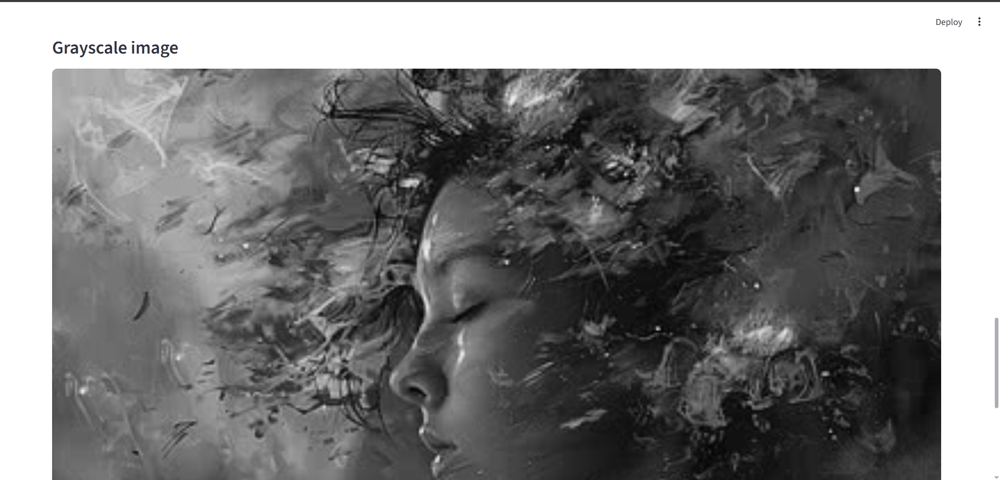
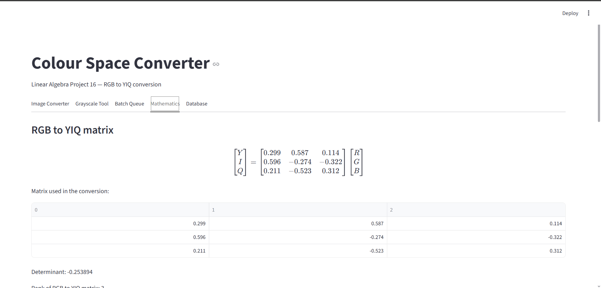
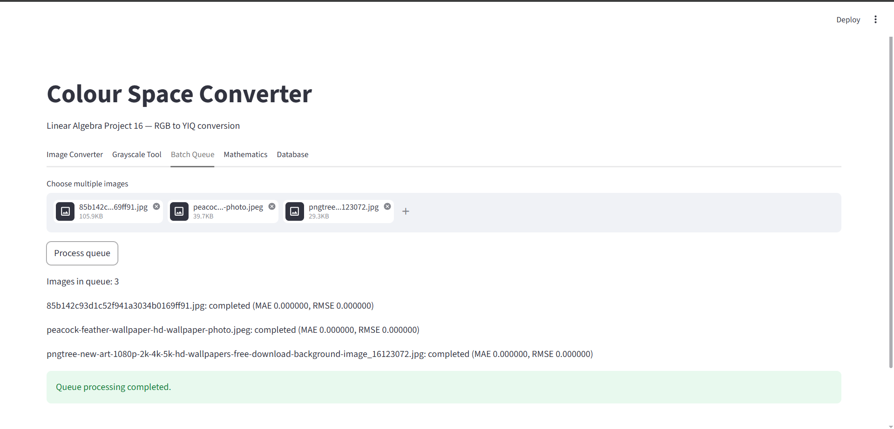

# Colour Space Converter

**Linear Algebra Project 16 — RGB to YIQ Conversion**

A Python-based image processing application that converts images from the RGB colour space to YIQ using a 3×3 matrix transformation, displays the individual Y, I and Q channels, reconstructs the RGB image using the inverse matrix, and compares the reconstructed image with the original.

## Features

- Upload an image for RGB to YIQ conversion.
- Display the Y, I and Q channels separately as grayscale images.
- Convert YIQ values back to RGB using the inverse transformation.
- Compare original and reconstructed images using Mean Absolute Error (MAE) and Root Mean Square Error (RMSE).
- Convert an RGB image to grayscale and explain the loss of colour information.
- Process multiple images through a FIFO batch queue.
- Store and display image conversion records using a database.
- Display the mathematical model, conversion matrix, determinant and rank.

## Linear Algebra Concepts

- **Linear transformation:** RGB to YIQ conversion is represented by a 3×3 matrix mapping coordinates in R³ to R³.
- **Change of basis:** Y, I and Q represent the colour in a different coordinate system.
- **Matrix inverse and determinant:** The inverse matrix is used for the reverse conversion. A non-zero determinant indicates that the transformation matrix is invertible.
- **Rank and null space:** Grayscale conversion maps three colour components to one brightness value, resulting in a rank-1 transformation and loss of colour information.

## Data Structures and Database

- **Queue:** Batch conversion jobs are processed in FIFO order.
- **Arrays:** Image pixels are represented and processed as arrays.
- **Database:** The application stores image and conversion history, including operation, error metrics, status and date.

## Project Structure

```text
Colour_Space_Converter_Project/
├── app/
├── db/
├── ds/
├── images/
├── math_engine/
├── tests/
├── .streamlit/
├── .gitignore
├── install.bat
├── main.py
├── README.md
├── requirements.txt
└── run.bat
```

## Requirements

- Python 3
- Packages listed in `requirements.txt`

## Setup and Run

Open a terminal in the project root directory and run:

```bash
python -m pip install -r requirements.txt
python -m streamlit run main.py
```

The application will open in the browser, usually at `http://localhost:8501`.

## Run Tests

From the project root directory:

```bash
python -m pytest -q
```

## Application Screenshots

### 1. Image Converter


### 2. YIQ Channels and Restoration


### 3. Restored Image and Error Metrics


### 4. Grayscale Tool


### 5. Grayscale Output



### 6. Mathematics



### 7. Batch Queue



### 8. Database Records


## Validation

The project's automated test suite was run locally with `pytest`. The recorded run completed with **42 tests passed**. Manual feature checks should also be performed in the local application before submission.

## Academic Integrity

The project implementation and mathematical concepts should be understood and explained by the team during the demonstration and viva. Any external or AI-assisted resources used during development should be acknowledged in the final project report according to the course handbook.

