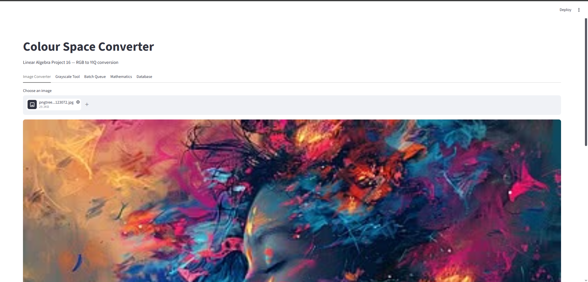
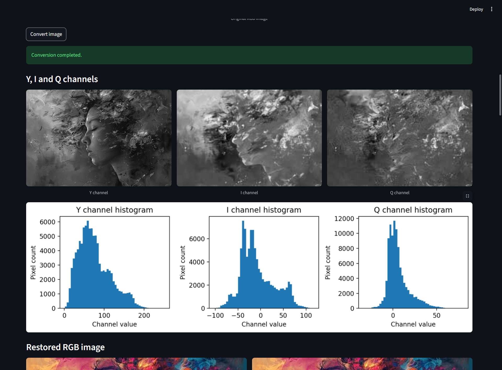
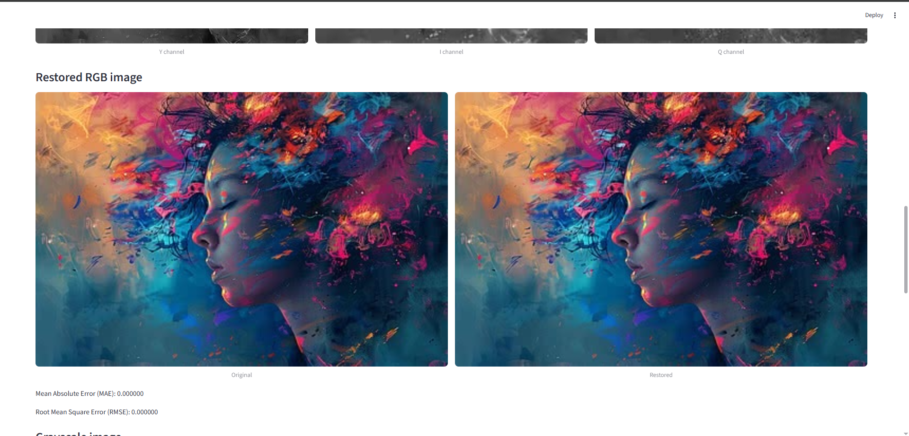
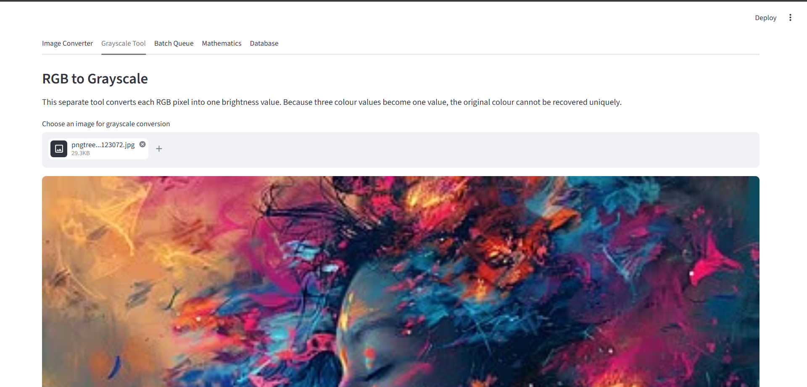
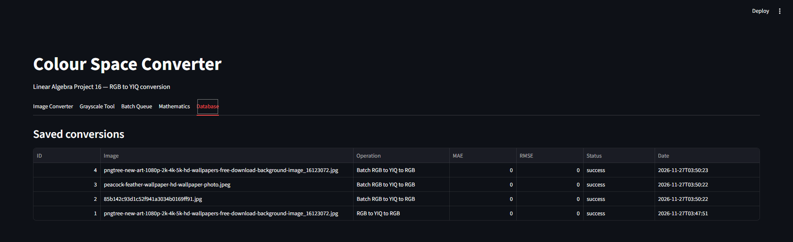

# Colour Space Converter

**Linear Algebra Project 16 — RGB to YIQ Conversion**

**Team:** Bharvi (2401441079) and Pragati (2401441081)  
**Department:** CSE, School of Engineering, JG University, Ahmedabad  
**GitHub:** https://github.com/bharvipatoliya1502/Colour-Space-Converter  
**Live app:** https://colour-space-converter.onrender.com  
**Report:** `report/Colour_Space_Converter_Report.pdf`

## Problem Statement and Real-World Context

Colour images are commonly stored as RGB, while television colour systems and some image-processing workflows use brightness plus colour-difference channels. Human vision is more sensitive to brightness than to colour detail, so separating luminance from chrominance can be useful. RGB-to-YIQ conversion applies a 3×3 matrix multiplication to every pixel.

## Features

- Upload images and convert RGB to YIQ using a 3×3 matrix.
- Preview Y, I and Q channels and display their histograms.
- Reconstruct RGB using the inverse matrix and compare images using MAE and RMSE.
- Convert grayscale through the 1×3 grayscale matrix.
- Display the grayscale null-space basis and a demo of two different RGB colours with the same gray value.
- Display projection matrix M = [1,1,1]ᵀG and verify M × M = M.
- Process batch jobs in FIFO order and record queued, processing, success and failed statuses.
- Store image metadata, colour-space matrix metadata and conversion history in SQLite.

## Linear Algebra Concepts

- **Linear transformation:** RGB to YIQ is a 3×3 matrix map from R³ to R³.
- **Change of basis:** RGB and YIQ are coordinate representations of the same colour in different coordinate systems.
- **Inverse and determinant:** The inverse matrix reconstructs RGB; a non-zero determinant indicates invertibility.
- **Rank and null space:** Grayscale G maps R³ to R¹, has rank 1 and nullity 2. Its null space contains colour changes that do not change luminance.
- **Grayscale as a projection:** The grayscale image represented in RGB is Mx, with M = [1,1,1]ᵀG and M² = M, a projection onto the gray axis along the null space of G (nullity 2).

## Data Structures and Database

- **Queue:** Batch jobs use a FIFO queue.
- **Arrays:** Pixel channels are represented as arrays.
- **SQLite tables:**
  - `images`: `image_id`, `filename`, `uploaded_at`, `width`, `height`, `file_format`.
  - `colour_spaces`: `colour_space_id`, `image_id`, `source_space`, `target_space`, `matrix_name`, `created_at`, `matrix_values`, `determinant`, `matrix_rank`.
  - `conversions`: `conversion_id`, `image_id`, `operation`, `mae`, `rmse`, `status`, `created_at`.
- Conversion status values are `queued`, `processing`, `success` and `failed`.
- The canonical schema is in `db/schema.sql`; `db/database.py` executes that file and migrates older databases when the matrix metadata columns are missing.

## Project Structure

```text
Colour_Space_Converter_Project/
├── app/
│   ├── __init__.py
│   ├── batch_processor.py
│   ├── interface.py
│   └── plots.py
├── db/
│   ├── __init__.py
│   ├── database.py
│   ├── queries.sql
│   ├── sample_data.sql
│   └── schema.sql
├── ds/
│   ├── __init__.py
│   └── batch_queue.py
├── math_engine/
│   ├── __init__.py
│   ├── converter.py
│   └── matrix.py
├── report/
│   └── .gitkeep
├── screenshots/
│   ├── 01_image_converter.png
│   ├── 02_yiq_channels_and_restoration.png
│   ├── 03_restored_image_and_error_metrics.png
│   ├── 04_grayscale_tool.png
│   ├── 05_grayscale_output.png
│   ├── 06_mathematics.png
│   ├── 07_batch_queue.png
│   └── 08_database_records.png
├── tests/
│   ├── __init__.py
│   ├── make_validation_results.py
│   ├── test_app_smoke.py
│   ├── test_batch_processor.py
│   ├── test_batch_processor_jobs.py
│   ├── test_converter.py
│   ├── test_database.py
│   ├── test_image_conversion.py
│   ├── test_linear_algebra_extensions.py
│   ├── test_plots.py
│   └── validation_results.md
├── .streamlit/  (local configuration; excluded from the ZIP)
├── .gitignore
├── install.bat
├── main.py
├── README.md
├── requirements.txt
└── run.bat
```

## Requirements

- Python 3
- Packages in `requirements.txt`, including Streamlit, NumPy, Pillow, Matplotlib and pytest.

## Setup and Run

```bash
python -m pip install -r requirements.txt
python -m streamlit run main.py
```

On Windows, `install.bat` installs the requirements and `run.bat` starts the application. The application normally opens at `http://localhost:8501`.

## Run Tests

```bash
python -m pytest -q
```

## Application Screenshots

### 1. Image Converter


### 2. YIQ Channels and Restoration


### 3. Restored Image and Error Metrics


### 4. Grayscale Tool


### 5. Grayscale Output


### 6. Mathematics


### 7. Batch Queue


### 8. Database Records


## Live Demo Note

The free Render instance may sleep while idle, so its first load can take about 50 seconds. SQLite history on Render may reset when the app restarts or is redeployed.

## Validation

The automated test run and environment details are recorded in [tests/validation_results.md](tests/validation_results.md). The AppTest smoke test is skipped automatically when Streamlit is not installed.

## Academic Integrity

The team wrote the from-scratch algorithms for matrix multiplication, determinant, inverse, rank and null space. NumPy linear-algebra routines are used only in tests for independent validation. AI tools used: ChatGPT and Claude, for planning, code discussion/debugging and drafting help. The team can explain the code used in the project.
